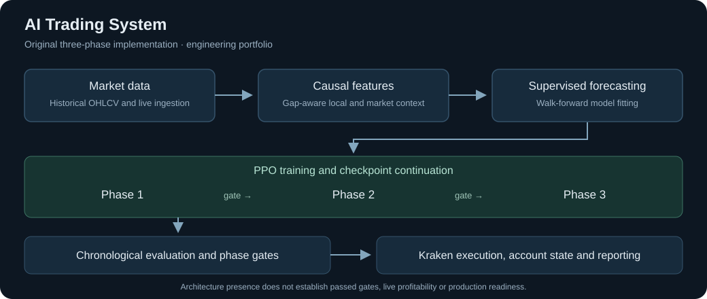

# AI Trading System

A Python project for processing crypto market data, training trading models and placing orders through Kraken.

Built by [Quietforge909](https://github.com/Quietforge909).



## My role

I planned the project structure, decided how the parts connect and designed the training process. I used AI tools to help write and debug the code.

## Try the demo

With Python 3.10 or later, run:

```bash
python3 -m examples.offline_demo
```

The demo buys and sells at sample prices using the original account calculations. It shows how fees affect a winning trade and a losing trade. It runs offline and needs no extra packages.

The prices and actions are scripted. This demo shows the accounting, not the performance of a trained model.

## The code

| Part | File |
|---|---|
| Process price data and handle missing candles | [features/pipeline_v3.py](features/pipeline_v3.py) |
| Train forecasts on earlier data and test on later data | [supervised/walk_forward_v3.py](supervised/walk_forward_v3.py) |
| Learn trading decisions with PPO | [rl/agent/model.py](rl/agent/model.py), [rl/agent/joint_policy.py](rl/agent/joint_policy.py) |
| Run the three training phases | [rl/training/trainer_v7.py](rl/training/trainer_v7.py) |
| Test trades and check whether a model can move to the next phase | [rl/evaluation/evaluate_phase1_v7.py](rl/evaluation/evaluate_phase1_v7.py), [rl/evaluation/phase_gate.py](rl/evaluation/phase_gate.py) |
| Track holdings and place orders | [live/state.py](live/state.py), [live/executor.py](live/executor.py) |
| Run scheduled trading cycles | [live/live_daemon.py](live/live_daemon.py) |

The system also includes position sizing, BUY/HOLD/SELL actions, fee calculations, saved checkpoints and Discord updates.

This is the original Kraken project. The newer Coinbase project is separate.

## What's included

This repo contains 47 unchanged Python files from the July 2026 project, plus the diagram and demo. The original file hashes are in [docs/source-manifest.json](docs/source-manifest.json).

Datasets, trained models, account records, API keys and old experiment logs are kept out. Full training and model testing need those additional data and model files. This repo does not provide verified trading returns or proof that all three phases passed.

The libraries used by the original code are listed in [requirements.txt](requirements.txt). Their versions are not pinned. The demo runs without them.

The [.env.example](.env.example) has empty credential fields and keeps live trading off.

To check that the original files match their saved hashes and look for common private-file patterns:

```bash
python3 scripts/check_export.py
```

This is a basic export check, not a full security audit.
